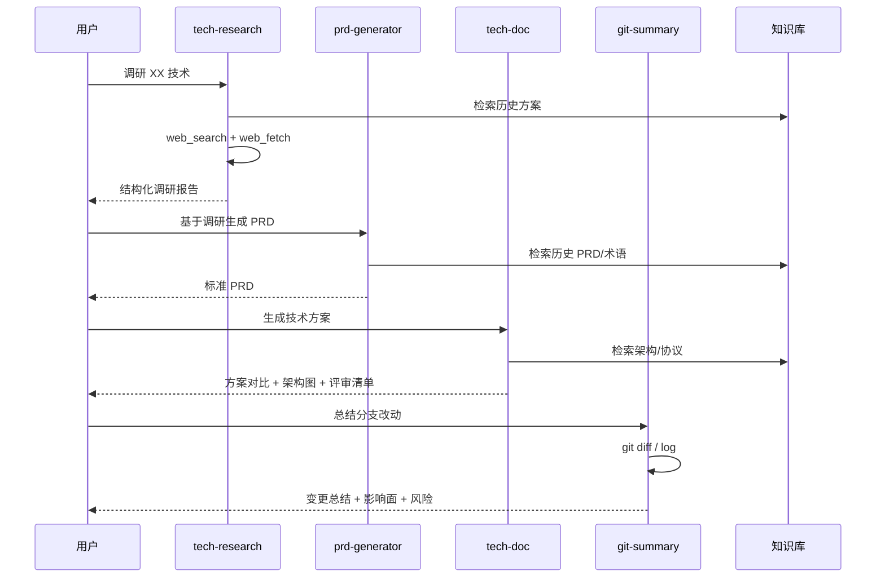

# 架构详解：基于 OpenClaw 的云手机研发智能体工作流

## 1. 设计目标

- **降低重复劳动**：让 Agent 承担检索、整理、格式化等重复工作
- **保证输出质量**：通过 RAG 和历史沉淀保证术语、格式、规范一致
- **加速研发闭环**：从调研 → 需求 → 方案 → 代码形成自动化流水线
- **可演示、可复用**：所有产物以 Markdown + Skill 形式沉淀，便于复用和展示

## 2. 分层架构

```
┌─────────────────────────────────────────────────────────────┐
│                    用户交互层                                │
│         WebChat / 命令行 / Cron 触发                         │
└─────────────────────────────────────────────────────────────
                              │
                              ▼
┌─────────────────────────────────────────────────────────────┐
│              OpenClaw 智能体编排层                           │
│  ┌─────────────┐  ┌─────────────┐  ┌─────────────┐         │
│  │  tech-research │ │  prd-generator │ │  git-summary  │         │
│  │  调研 Agent   │  │  文档 Agent    │  │  代码 Agent  │         │
│  └─────────────┘  └─────────────┘  └─────────────┘         │
│  ┌─────────────────────────────────────────────────┐         │
│  │        tech-doc（方案/评审 Agent）              │         │
│  └─────────────────────────────────────────────────┘         │
└─────────────────────────────────────────────────────────────┘
                              │
                              ▼
┌─────────────────────────────────────────────────────────────┐
│                  RAG 私有知识库层                            │
│  ┌─────────────┐  ┌─────────────┐  ┌─────────────────────┐  │
│  │  协议文档    │  │  架构文档    │  │  历史 PRD/方案/总结  │  │
│  │  protocols  │  │ architecture │  │      history        │  │
│  └─────────────┘  └─────────────┘  └─────────────────────┘  │
└─────────────────────────────────────────────────────────────┘
                              │
                              
┌─────────────────────────────────────────────────────────────┐
│                    工具与调度层                              │
│  ┌──────────┐  ┌──────────  ┌──────────┐  ┌──────────┐    │
│  │ web_search │ │ web_fetch  │ │  git/exec  │ │   cron     │    │
│  └──────────┘  └──────────┘  └──────────┘  └──────────┘    │
└─────────────────────────────────────────────────────────────┘
```

## 3. Agent 协作流程



## 4. 关键技术点

| 技术点 | 实现方式 |
|--------|----------|
| 多 Agent 编排 | `sessions_spawn` + `sessions_yield` |
| RAG | `memory_search` + `memory_get` 检索本地知识库 |
| 外部信息检索 | `web_search` + `web_fetch` |
| 架构图生成 | Mermaid/SVG，可结合 `diagram-maker` skill |
| 定时任务 | OpenClaw `cron`（技术雷达、每日复盘） |
| Git 集成 | `exec git ...` |

## 5. 数据流

1. **输入**：用户需求 / 调研主题 / 代码分支
2. **检索**：Agent 优先检索本地知识库
3. **补充**：必要时调用网络搜索或 Git 命令
4. **生成**：按模板输出结构化 Markdown
5. **归档**：保存到 `memory/` 对应目录
6. **索引**：更新 `INDEX.md`，支持后续 RAG

## 6. 可扩展性

- 新增 Skill 只需在 `workspace/skills/` 下创建目录
- 知识库可随时扩展新文档，自动被 `memory_search` 索引
- Cron 任务可灵活增加新周期任务
