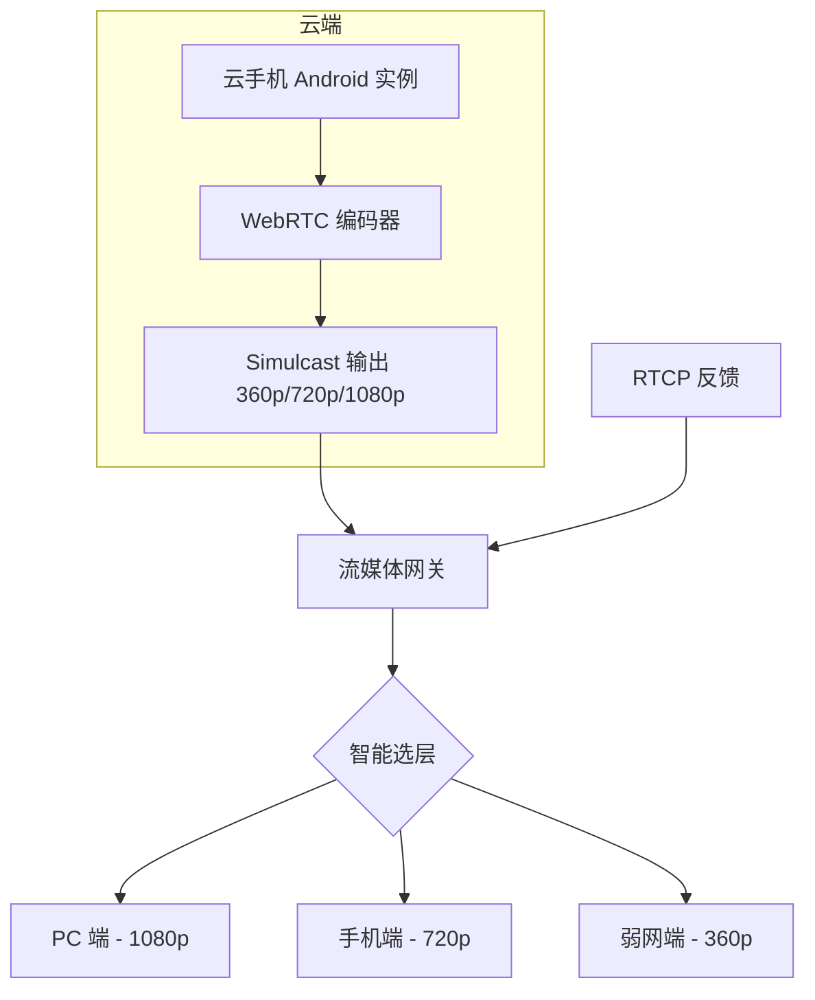

# 云手机弱网自适应技术方案

| 项目 | 内容 |
|------|------|
| 版本 | v1.0 |
| 日期 | 2026-09-04 |
| 作者 | OpenClaw Tech-Doc Agent |
| 状态 | 已归档 |

---

## 1. 背景与目标

### 1.1 背景
云手机用户通过公网访问云端 Android 实例，视频流实时传输到终端。弱网环境下（带宽不足、抖动、丢包），视频卡顿、花屏、延迟高的问题严重影响用户体验。

### 1.2 目标
设计并实现一套适合云手机场景的弱网自适应方案，实现：
- 实时感知网络状况
- 动态调整视频质量
- 保障交互流畅性
- 降低运营成本

---

## 2. 候选方案对比

| 评估维度 | 方案 A：动态码率控制 | 方案 B：Simulcast | 方案 C：SVC |
|----------|-------------------|------------------|------------|
| 实现复杂度 | 低 | 中 | 中高 |
| 带宽利用率 | 高 | 中 | 中高 |
| 弱网降档平滑度 | 平滑 | 可能有跳变 | 平滑 |
| 多终端适配 | 差 | 好 | 好 |
| 对 SFU 要求 | 低 | 中 | 高 |
| CPU 开销 | 低 | 高 | 中 |
| 浏览器兼容性 | 最好 | 好 | 有限 |
| 落地难度 | 低 | 中 | 高 |
| **综合推荐** | 短期兜底 | **主推荐** | 长期演进 |

---

## 3. 推荐方案

**推荐采用「Simulcast + 动态码率控制」组合方案**

### 3.1 架构设计

### 3.2 关键模块说明

| 模块 | 职责 |
|------|------|
| 网络质量监测 | 采集 RTT、丢包率、抖动、带宽 |
| 带宽估计（BWE） | 基于 GCC 估算可用带宽 |
| Simulcast 编码 | 云端输出多路不同质量流 |
| 智能选层 | 网关根据接收端带宽选层转发 |
| 动态码率控制 | 在单流内进一步微调码率 |
| 回升策略 | 网络恢复后平滑回升画质 |

---

## 4. 风险与应对

| 风险 | 影响 | 应对策略 |
|------|------|----------|
| 云端 CPU 开销增加 | 单实例并发下降 | GPU 编码加速，限制 Simulcast 层数为 3 层 |
| 层间切换卡顿 | 用户体验下降 | 切换时请求关键帧，增加缓冲和防抖 |
| 网络波动频繁切换 | 画质不稳定 | 引入滞后和切换阈值，避免频繁切换 |
| 终端不支持 Simulcast | 部分用户无法受益 | 动态协商，回退到单流动态码率 |

---

## 5. 实施计划

| 阶段 | 任务 | 交付物 | 时间 |
|------|------|--------|------|
| 1 | 原型验证 | PoC 报告 | 2 周 |
| 2 | Simulcast 编码集成 | 编码模块 | 3 周 |
| 3 | 网关选层策略 | 网关模块 | 3 周 |
| 4 | 性能优化 | 压测报告 | 2 周 |
| 5 | 灰度上线 | 上线文档 | 2 周 |

---

## 6. 评审检查清单

- [ ] 需求对齐：方案覆盖所有 PRD 功能需求
- [ ] 技术可行性：Simulcast 和 GCC 在云手机场景可落地
- [ ] 性能：端到端延迟 < 200ms
- [ ] 风险：CPU 开销和切换卡顿已识别并应对
- [ ] 可观测：监控指标完整
- [ ] 验收：弱网卡顿率下降 >= 40%
