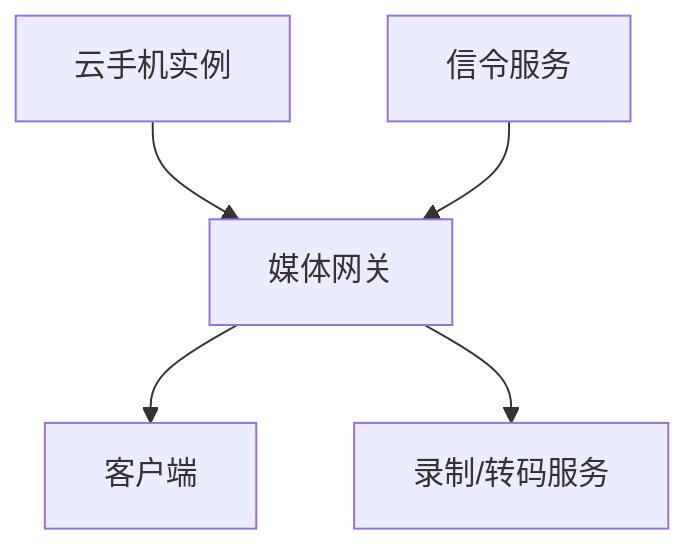

# 云手机媒体网关技术方案

| 项目 | 内容 |
|------|------|
| 版本 | v1.0 |
| 日期 | 2026-08-30 |
| 作者 | OpenClaw Tech-Doc Agent |
| 状态 | 已归档 |

---

## 1. 背景与目标

### 1.1 背景
云手机视频流需要低延迟、高画质、弱网自适应，媒体网关是核心瓶颈。

### 1.2 目标
选择并落地一套适合云手机场景的媒体网关方案。

---

## 2. 候选方案对比

| 评估维度 | 方案 A：自研网关 | 方案 B：Mediasoup | 方案 C：Janus |
|----------|----------------|-------------------|--------------|
| 性能 | 高，可深度定制 | 中高 | 中 |
| 成本 | 高（人力） | 低 | 低 |
| 兼容性 | 好 | 好 | 一般 |
| 可维护性 | 差 | 好 | 中 |
| 落地难度 | 高 | 中 | 低 |
| **综合推荐** | 长期 | **短期推荐** | 备选 |

---

## 3. 推荐方案

### 3.1 架构设计

### 3.2 关键模块
- 接入层：WebRTC/UDP
- 调度层：房间/流管理
- 媒体处理：编码、码率自适应
- 控制面：信令、状态同步

---

## 4. 风险与应对

| 风险 | 影响 | 应对策略 |
|------|------|----------|
| 弱网卡顿 | 用户体验差 | 实现 FEC/ARQ、码率自适应 |
| 高并发延迟 | 服务抖动 | 网关无状态化 + 负载均衡 |

---

## 5. 实施计划

| 阶段 | 任务 | 交付物 | 时间 |
|------|------|--------|------|
| 1 | 原型验证 | PoC 报告 | 2周 |
| 2 | 性能优化 | 压测报告 | 2周 |
| 3 | 集成上线 | 上线文档 | 1周 |

---

## 6. 评审检查清单

- [ ] 需求对齐：方案覆盖所有性能指标
- [ ] 技术可行性：PoC 验证通过
- [ ] 风险：弱网/并发风险已识别并应对
- [ ] 验收：压测指标达标
