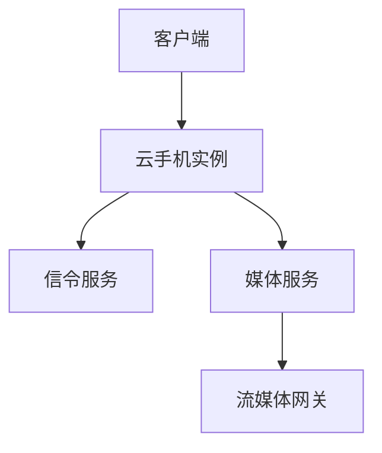

# <方案名称> 技术方案

| 项目 | 内容 |
|------|------|
| 版本 | v1.0 |
| 日期 | YYYY-MM-DD |
| 作者 | OpenClaw Tech-Doc Agent |
| 状态 | 草稿/评审中/已归档 |

---

## 1. 背景与目标

### 1.1 背景
### 1.2 目标
### 1.3 约束条件

---

## 2. 候选方案对比

| 评估维度 | 方案 A | 方案 B | 方案 C |
|----------|--------|--------|--------|
| 性能 | | | |
| 成本 | | | |
| 兼容性 | | | |
| 安全性 | | | |
| 可维护性 | | | |
| 落地难度 | | | |
| **综合推荐** | | | |

---

## 3. 推荐方案

### 3.1 架构设计

### 3.2 关键模块说明

### 3.3 数据流/控制流

---

## 4. 风险与应对

| 风险 | 影响 | 应对策略 |
|------|------|----------|
| | | |

---

## 5. 实施计划

| 阶段 | 任务 | 交付物 | 时间 |
|------|------|--------|------|
| 1 | | | |

---

## 6. 评审检查清单

- [ ] 需求对齐：方案是否覆盖了全部需求？
- [ ] 技术可行性：关键技术是否已有成熟实践？
- [ ] 性能：是否满足性能/延迟指标？
- [ ] 安全：是否存在数据/接口安全风险？
- [ ] 可运维：是否具备监控、降级、回滚能力？
- [ ] 依赖：外部依赖是否已明确并可控？
- [ ] 验收：是否有明确的验收标准和测试方案？
